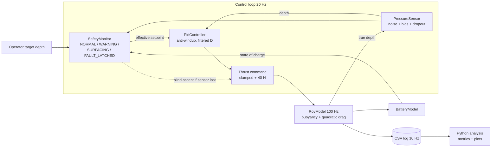
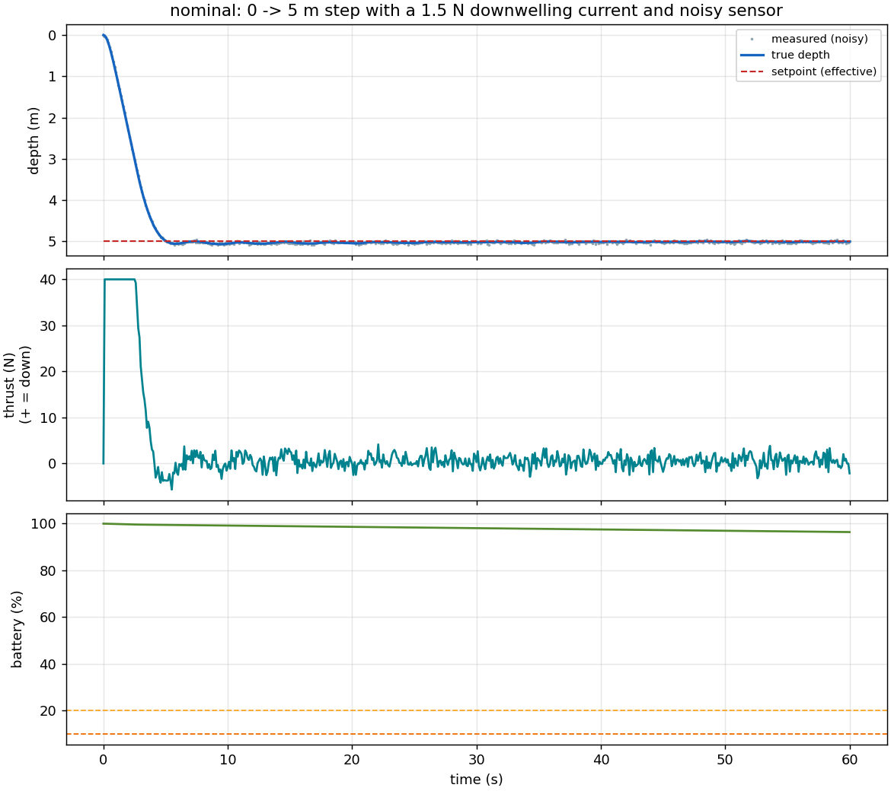
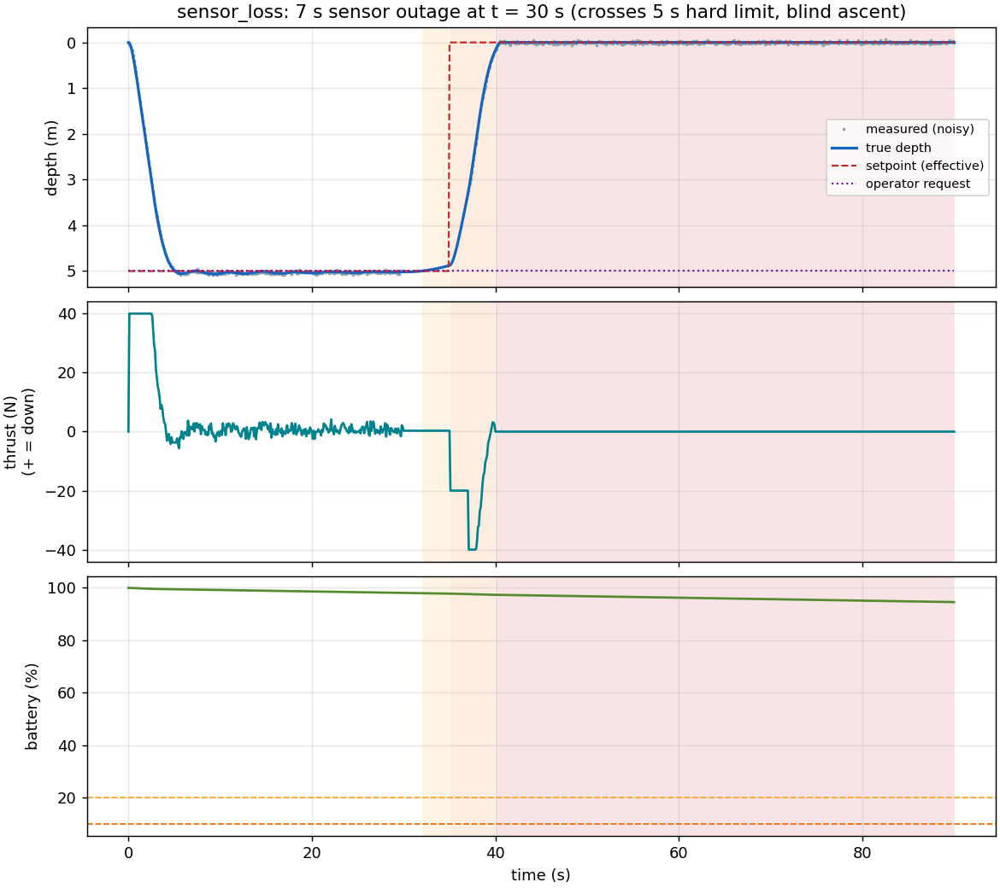

# rov-depth-sim

A C++17 simulation of an underwater ROV holding a target depth, with a PID depth controller, a noisy pressure sensor, a battery model and a **fail-safe state machine** that surfaces the vehicle when a limit is violated. Python tools analyse the logs (overshoot, rise and settling time, plots).

It is a software-in-the-loop model of the kind of depth-hold + fault-handling logic an ROV flight stack needs, built to be tested: **58 C++ unit/integration tests and 14 Python tests**.

## Architecture



| Component | File | What it does |
|---|---|---|
| `RovModel` | `src/rov_model.cpp` | 1-D vertical dynamics: `m dv/dt = thrust + net_weight + current - c_d v\|v\|`, semi-implicit Euler at 100 Hz, surface as a hard wall |
| `PressureSensor` | `src/pressure_sensor.cpp` | Seeded Gaussian noise, bias, scheduled dropouts (returns `nullopt`) |
| `PidController` | `src/pid_controller.cpp` | Conditional-integration anti-windup, derivative on measurement (no setpoint kick), low-pass filtered D, variable `dt` |
| `BatteryModel` | `src/battery_model.cpp` | Idle load + thruster power growing with thrust squared |
| `SafetyMonitor` | `src/safety_monitor.cpp` | Escalating fail-safe state machine, see [docs/safety.md](docs/safety.md) |
| `run_scenario` | `src/simulation.cpp` | Wires everything together; plant 100 Hz, sensor/controller/safety 20 Hz |

## Build and run

Requires a C++17 compiler and CMake 3.14+. GoogleTest is found on the system or downloaded automatically.

```bash
cmake -B build -DCMAKE_BUILD_TYPE=Release
cmake --build build
ctest --test-dir build --output-on-failure   # 58 C++ tests

./build/run_sim --list                       # nominal sensor_dropout sensor_loss low_battery depth_limit
./build/run_sim nominal results/nominal.csv

python -m venv .venv && . .venv/bin/activate # Windows: .venv\Scripts\activate
pip install -r python/requirements.txt
pytest python                                # 14 Python tests
python python/rov_analysis.py results/nominal.csv --target 5 --plot results/nominal.png
python scripts/run_all.py build/run_sim      # all scenarios -> results/*.png + results/results.md
```

## Results

Nominal scenario: 0 → 5 m step, 1.5 N downwelling current, 2 cm sensor noise (see [results/results.md](results/results.md) for every scenario and plot).

| metric | value |
|---|---|
| overshoot | 1.34 % |
| rise time (10–90 %) | 3.20 s |
| settling time (2 % band) | 4.70 s |
| steady-state error | +0.007 m |

The tests additionally check that the loop holds 5 m (within 0.1 m, under 10 % overshoot) against vertical disturbance forces from −3 N to +4 N.



### Fault scenarios

| scenario | what happens | result |
|---|---|---|
| `sensor_dropout` | 3 s sensor outage | WARNING after 2 s, recovers to NORMAL, depth held |
| `sensor_loss` | 7 s sensor outage | WARNING → SURFACING at 5 s → blind open-loop ascent → FAULT_LATCHED at the surface, thrusters off |
| `low_battery` | starts at 24 % charge | WARNING at 20 % → SURFACING at 10 % → FAULT_LATCHED |
| `depth_limit` | operator asks for 12 m, limit is 10 m | WARNING at 9 m → SURFACING past 10 m (operator request overridden) → FAULT_LATCHED |



## Design notes

* **Positive buoyancy as a passive fail-safe.** The vehicle floats if the thrusters stop, so `FAULT_LATCHED` (thrusters off) is a safe state.
* **Hard faults latch.** Once `SURFACING`, the monitor never returns to `NORMAL` on its own, even if the sensor comes back. A vehicle that lost its sensor should not resume the mission automatically. Soft warnings do clear.
* **Short dropouts hold the last thrust command** instead of acting on stale data; long ones trigger a blind ascent.
* **Fixed time steps and a seeded RNG** make every run reproducible, so tests are deterministic.
* **PID gains were chosen by a grid search** over `kp, ki, kd` and the derivative filter constant on the nominal step, minimising thrust jitter subject to overshoot < 5 % and settling < 10 s. The values are in `default_gains()`.

## Testing

* `tests/test_rov_model.cpp`: terminal velocity matches the analytic `sqrt(F/c_d)`, thrust clamping, surface wall, current disturbance
* `tests/test_pid_controller.cpp`: anti-windup, no derivative kick, `dt` independence, saturation, reset, convergence on a first-order plant
* `tests/test_pressure_sensor.cpp`: noise mean/std, bias, determinism, dropout length
* `tests/test_battery_model.cpp`: drain rate, thrust-dependent drain, floor at 0
* `tests/test_safety_monitor.cpp`: every state transition and both latching rules
* `tests/test_closed_loop.cpp`: full scenarios, determinism, disturbance rejection, CSV output
* `python/tests`: metric functions checked against closed-form results (second-order overshoot `exp(-πζ/√(1-ζ²))`, first-order rise and settling times)

The tests were also checked for sensitivity by injecting deliberate bugs (no anti-windup, un-latched surfacing, derivative on error, wrong drag sign, wrong dropout limit); each was caught.

## Limitations and possible extensions

* One degree of freedom (depth only); no attitude, lateral motion or tether dynamics.
* The model is not calibrated against a real vehicle; parameters are plausible, not measured.
* Not implemented yet: ROS 2 nodes publishing the telemetry, and a MAVLink bridge (`pymavlink`). The log format and the `run_scenario` loop are the natural integration points.
