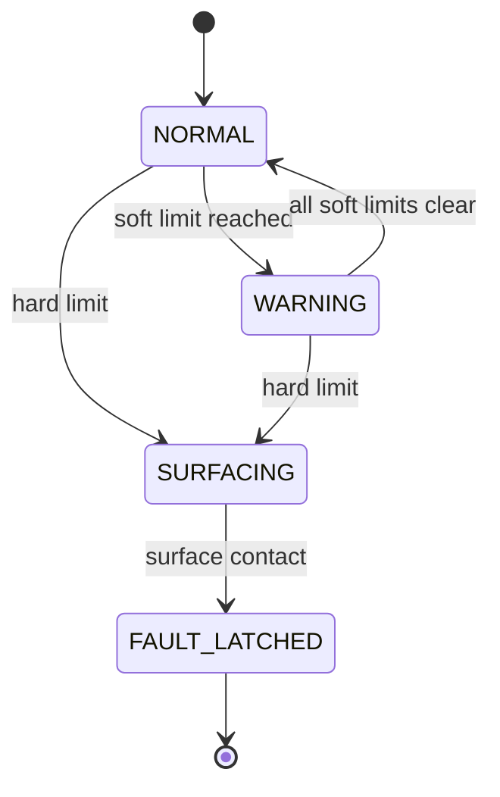

# Safety monitor rules

The `SafetyMonitor` runs every control cycle (20 Hz) on four inputs: best depth estimate, battery state of charge, whether the depth sensor delivered a reading, and an independent surface-contact flag.

## States

| State | Meaning | Operator setpoint | Thrusters |
|---|---|---|---|
| `NORMAL` | all checks pass | followed | PID |
| `WARNING` | a soft limit is exceeded | followed | PID |
| `SURFACING` | a hard limit is exceeded | **overridden to 0 m** | PID (or blind ascent if no sensor) |
| `FAULT_LATCHED` | surfaced after a hard fault | 0 m | **off** (vehicle is positively buoyant) |

## Triggers

| Condition | Soft limit → WARNING | Hard limit → SURFACING |
|---|---|---|
| Depth | ≥ 90 % of max depth (9 m) | > max depth (10 m) |
| Battery state of charge | ≤ 20 % | ≤ 10 % |
| Depth sensor silence | ≥ 2 s | ≥ 5 s |

## Transitions

* `WARNING` is not latched: it clears as soon as the condition clears (for example the sensor returns).
* `SURFACING` is **latched**: it never returns to `NORMAL`/`WARNING`, even if the triggering condition disappears. Resuming a mission after a hard fault must be a deliberate operator action, not automatic.
* If a hard limit is reached while already at the surface, the monitor goes directly to `FAULT_LATCHED`.
* `FAULT_LATCHED` is terminal.

## Behaviour with the sensor lost

* Short outage (< 5 s): the controller holds the last thrust command rather than acting on stale data.
* Hard outage (≥ 5 s): the vehicle ascends **open loop** at a fixed upward thrust. When readings come back the PID resumes with the setpoint forced to 0 m. The latch to `FAULT_LATCHED` uses the independent surface-contact flag, not the depth sensor.

## Test coverage

Each row of the tables above, every transition in the diagram and both latching rules have a dedicated test in `tests/test_safety_monitor.cpp`, with end-to-end versions in `tests/test_closed_loop.cpp`.
