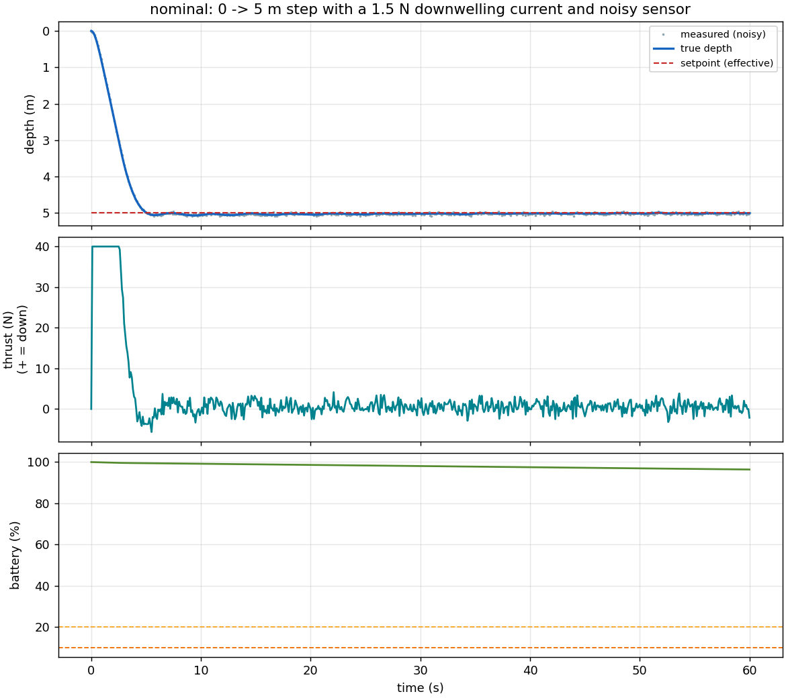
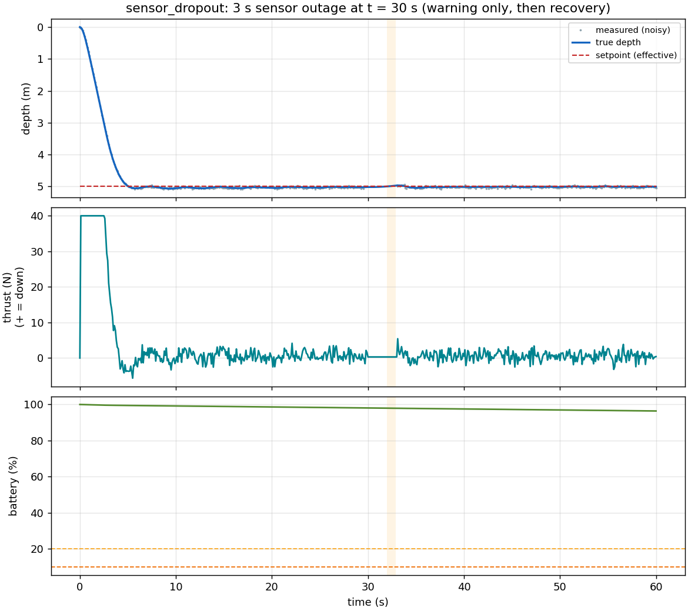
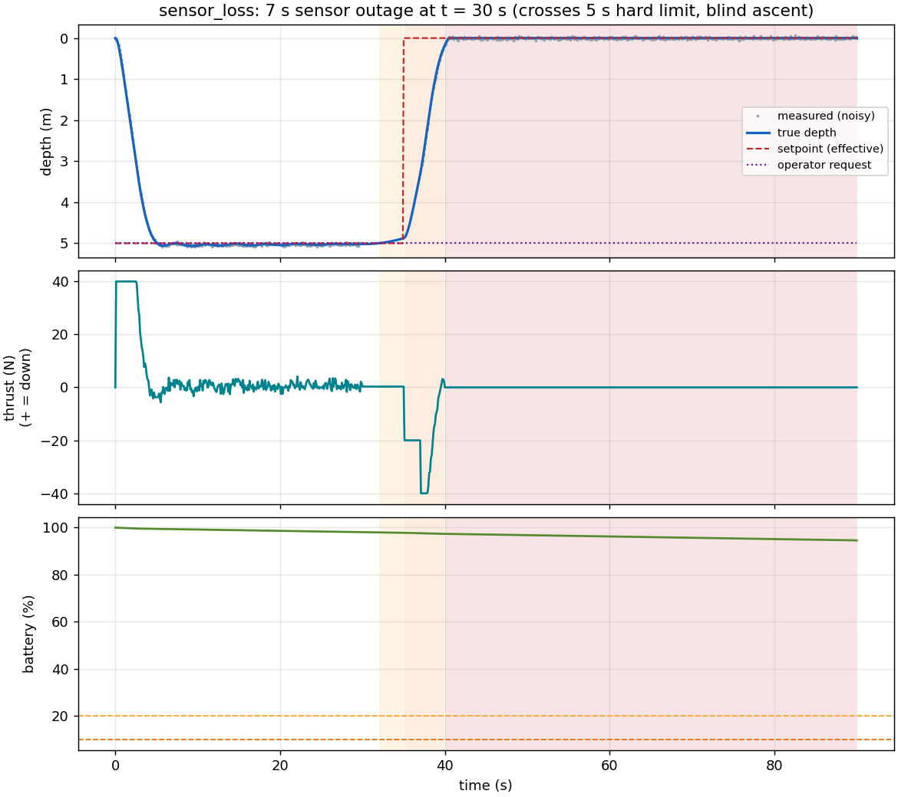
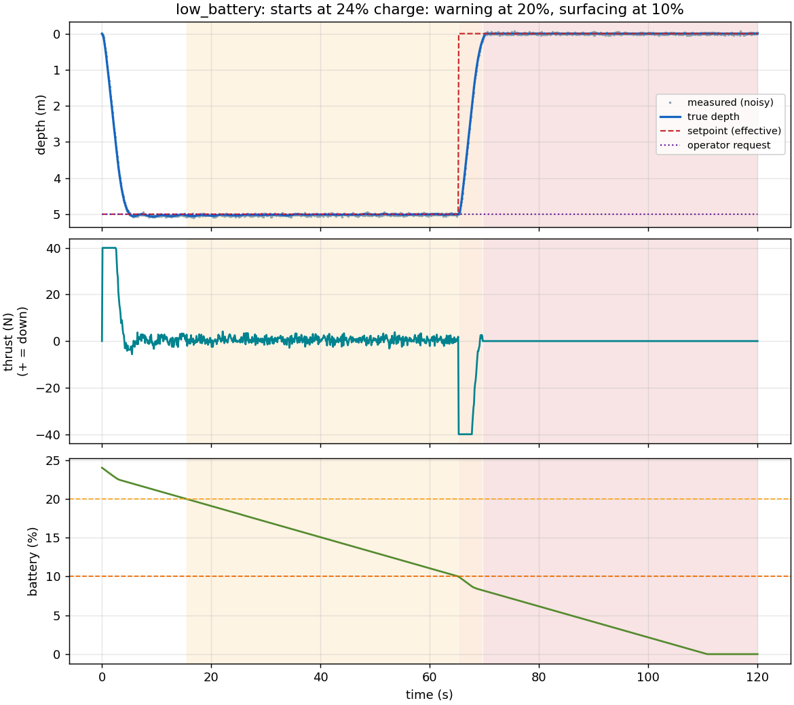
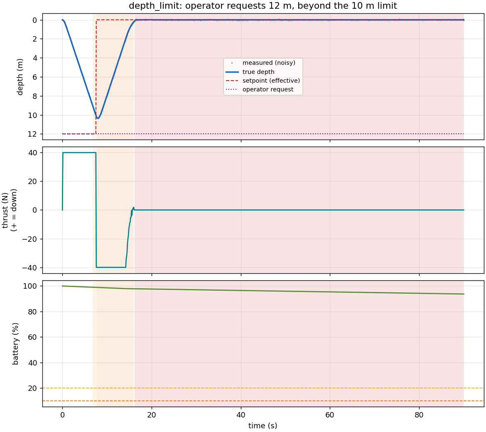

# Simulation results

Generated by `scripts/run_all.py`.

## nominal

0 -> 5 m step with a 1.5 N downwelling current and noisy sensor

| metric | value |
|---|---|
| overshoot | 1.34 % |
| rise time (10-90%) | 3.20 s |
| settling time (2% band) | 4.70 s |
| steady-state error | +0.0069 m |

## sensor_dropout

3 s sensor outage at t = 30 s (warning only, then recovery)

| time | transition |
|---|---|
| 32.0 s | NORMAL -> WARNING |
| 33.0 s | WARNING -> NORMAL |

## sensor_loss

7 s sensor outage at t = 30 s (crosses 5 s hard limit, blind ascent)

| time | transition |
|---|---|
| 32.0 s | NORMAL -> WARNING |
| 35.0 s | WARNING -> SURFACING |
| 40.0 s | SURFACING -> FAULT_LATCHED |

## low_battery

starts at 24% charge: warning at 20%, surfacing at 10%

| time | transition |
|---|---|
| 15.4 s | NORMAL -> WARNING |
| 65.3 s | WARNING -> SURFACING |
| 69.7 s | SURFACING -> FAULT_LATCHED |

## depth_limit

operator requests 12 m, beyond the 10 m limit

| time | transition |
|---|---|
| 6.8 s | NORMAL -> WARNING |
| 7.6 s | WARNING -> SURFACING |
| 16.1 s | SURFACING -> FAULT_LATCHED |
